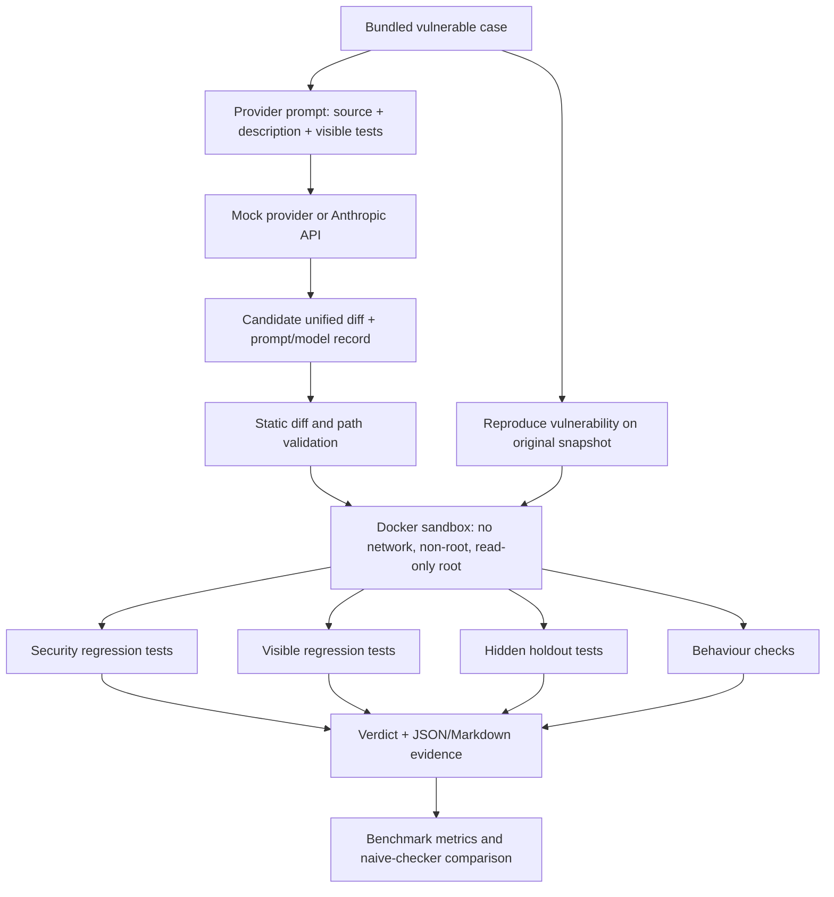

# PatchProof

PatchProof is a small verification engine for AI-proposed security fixes. It
checks whether a diff fixes a known vulnerability in a bundled demonstration
case without breaking that case's expected behaviour. A model's patch is
untrusted input; passing a visible security test alone is not enough for a
verified verdict.

PatchProof is **not a general-purpose vulnerability scanner**. It currently
supports only the three intentionally vulnerable cases shipped under `lab/`.
It does not scan arbitrary repositories, software versions, hosts, or services.

## Architecture



## Quick start

Requirements: Node.js `>=22.13 <23`, npm, and Docker with permission to access
its daemon. The full verify and benchmark commands require Docker.

```sh
npm ci
npm run lint
npm run typecheck
npm test
npm run sandbox:build
```

For a smoke test, first verify the known-good reference patch:

```sh
npm run dev -- verify --case sql-injection --patch lab/cases/sql-injection/reference.patch
```

Then try the deliberately narrow patch, which blocks only known payloads:

```sh
npm run dev -- verify --case sql-injection --patch lab/cases/sql-injection/known-bad/narrow-blacklist.patch
```

Successful and unsuccessful checks write JSON and Markdown evidence to
`results/<case>/<run-id>/`. The CLI prints the verdict and relative evidence
paths. These are captured outputs from real Docker sandbox runs in this
repository:

```json
{
  "verdict": "VERIFIED_FIX",
  "reasoning": "The patch reproduces the baseline flaw, passes security and regression checks, and preserves holdout and behaviour checks.",
  "runId": "20261017T145514414Z-8dd9b38b",
  "evidence": {
    "json": "results/sql-injection/20261017T145514414Z-8dd9b38b/verification.json",
    "markdown": "results/sql-injection/20261017T145514414Z-8dd9b38b/verification.md"
  }
}
```

The narrow blacklist is expected to produce `FALSE_SUCCESS`: visible payloads
are blocked, but a mutated holdout payload still exercises the vulnerability.
The patch that disables the endpoint instead produces `REGRESSION`. These are
expected outcomes, not a promise that arbitrary patches can be classified
perfectly.

The narrow blacklist was also run in the sandbox and returned:

```json
{
  "verdict": "FALSE_SUCCESS",
  "reasoning": "Visible checks pass, but at least one hidden holdout test fails.",
  "runId": "20261017T145514670Z-6cc5d26e",
  "evidence": {
    "json": "results/sql-injection/20261017T145514670Z-6cc5d26e/verification.json",
    "markdown": "results/sql-injection/20261017T145514670Z-6cc5d26e/verification.md"
  }
}
```

The endpoint-disabling patch returned `REGRESSION` because the existing
account lookup no longer works. These examples are from the generated local
evidence and are not checked into Git; rerunning the commands creates new
run IDs.

## Propose a patch

The mock provider needs no credentials and deterministically cycles through a
reference fix, an ineffective change, a narrow blacklist, an endpoint-disabling
patch, and an invalid patch:

```sh
npm run dev -- propose --case sql-injection --provider mock
npm run dev -- propose --case sql-injection --provider mock --attempt 3
```

The diff and `proposal.json` are saved under `results/proposals/`. Each record
contains the exact prompt, provider/model ID, generation parameters, prompt and
source hashes, patch hash, and (for mock runs) the scenario name.

Anthropic is opt-in. Set `ANTHROPIC_API_KEY` in the environment; never commit an
API key. `.env.example` documents the variable names and contains no secret.
`ANTHROPIC_MODEL` can override the default model:

```sh
ANTHROPIC_API_KEY=... npm run dev -- propose --case sql-injection --provider anthropic
```

The provider prompt contains the vulnerable source, case description, visible
security tests, and visible regression tests. It never reads or includes
holdout tests, known-bad patches, or the reference patch. The tests and lab
code are public to a human inspecting this repository, so this is not a
secret-test benchmark against a model that can inspect the repository.

## Benchmark

Run five deterministic mock attempts per bundled case:

```sh
npm run bench -- --provider mock --attempts 5
```

Reports are written to `results/benchmarks/<benchmark-id>/`. The JSON includes
counts and rates for each verdict overall and by case, per-attempt evidence
paths, model IDs, naive-checker accepts, and false accepts. The Markdown
compares the naive rule ("the visible security test passes") with PatchProof's
`VERIFIED_FIX` verdict.

One completed mock run on Node `v22.22.1` (benchmark
`20261017T145407459Z-02789cb2`, 5 attempts per case) produced:

| Verdict | Count | Rate |
|---|---:|---:|
| `VERIFIED_FIX` | 3 | 20% |
| `FAILED_FIX` | 3 | 20% |
| `REGRESSION` | 3 | 20% |
| `FALSE_SUCCESS` | 3 | 20% |
| `INVALID_PATCH` | 3 | 20% |
| `INVALID_CASE` | 0 | 0% |
| `SANDBOX_ERROR` | 0 | 0% |

The naive checker accepted 9/15 attempts, including 6 that PatchProof did not
verify; PatchProof verified 3. This deterministic mock result validates the
benchmark wiring and known fixtures. It is not a measurement of Anthropic or
any other model's fix rate.

CI runs this mock benchmark and fails if it does not catch at least one
false-success case. A separate manually triggered GitHub Actions workflow runs
the Anthropic benchmark using the `ANTHROPIC_API_KEY` repository secret and
uploads its evidence as a workflow artifact.

## Verification pipeline

For a valid patch, PatchProof:

1. Confirms the original vulnerable snapshot fails its security test and
   passes the case's reproduction test.
2. Validates one unified diff for exactly `source.ts`, with path, format, byte,
   and changed-line limits. Tests, configuration, lockfiles, and CI files
   cannot be changed by the candidate patch.
3. Builds and runs the sandbox image. Candidate source is applied and tested
   only inside the container.
4. Runs security, visible regression, hidden holdout, and behaviour tests.
5. Writes source and patch hashes, stage results/output, sandbox settings,
   verdict, and reasoning to JSON and Markdown evidence.

The runner uses Docker `--network=none`, a read-only root filesystem, a
non-root UID, dropped capabilities, `no-new-privileges`, CPU/memory/process
limits, bounded writable tmpfs mounts, and per-stage timeouts. The image is
built before the candidate patch is supplied; runtime patch execution receives
no API key or host credential.

Verdicts include `VERIFIED_FIX`, `FAILED_FIX`, `REGRESSION`, `FALSE_SUCCESS`,
`INVALID_PATCH`, `INVALID_CASE`, and `SANDBOX_ERROR`. `FALSE_SUCCESS` means
visible security checks passed but a holdout or behaviour check did not.

## Limitations

- Only three small local demonstration cases are implemented: SQL injection
  (CWE-89), IDOR/BOLA (CWE-639), and path traversal (CWE-22). There is no
  general codebase scanner, automatic case generator, or support for arbitrary
  application test suites.
- Hidden tests are withheld from the model prompt, but they are present in
  this public repository and visible to people. They are independent checks,
  not secret oracles.
- A passing finite test suite is evidence for these cases, not proof of
  security for all inputs or environments. The lab and its holdouts are small
  and cannot represent production systems.
- Docker isolation is a risk-reduction boundary, not a formal proof against
  kernel, runtime, or supply-chain vulnerabilities. Do not run this on a host
  whose Docker daemon is shared with sensitive workloads.
- Anthropic proposals send the bundled source and visible tests to Anthropic.
  Do not point the provider at private application data. Mock runs are fully
  local and deterministic.
- Real-model outputs can vary with model/provider revisions. The model ID,
  parameters, prompt, and hashes are recorded; this does not make a live API
  response deterministic.
- This project does not claim to solve AI security or to establish that a
  proposed fix is safe outside the tested case.

## How this was built

This project was built with an AI coding agent under the project owner's
direction and review. The owner approved the staged plan, reviewed changes,
and used targeted tests and explicit sandbox boundaries. The agent did not
replace human review or independently establish production readiness.

## Vulnerable lab warning

`lab/` intentionally contains vulnerable source snapshots and deliberately
unsafe examples. They exist only for the bundled local tests. **Never deploy,
expose, or reuse these snapshots in a real application.** The tests bind only
to loopback on ephemeral ports. PatchProof is intended for this local lab and
authorized defensive research.

See [docs/METHODOLOGY.md](docs/METHODOLOGY.md),
[docs/THREAT_MODEL.md](docs/THREAT_MODEL.md), and
[docs/DECISIONS.md](docs/DECISIONS.md) for the experiment design and security
assumptions. Personal demo/interview notes are kept in the ignored
`INTERVIEW_NOTES.md` file and are not included in commits.
